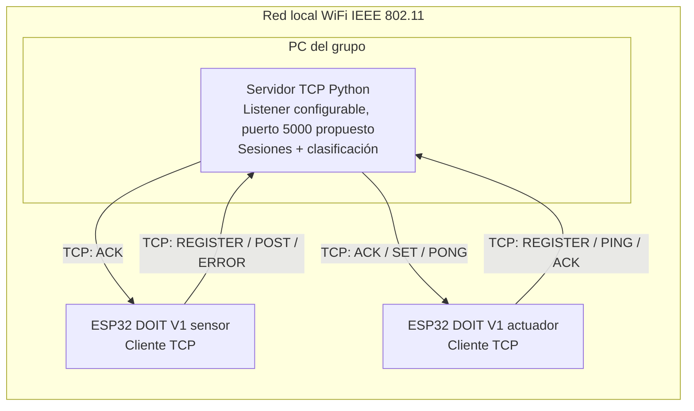
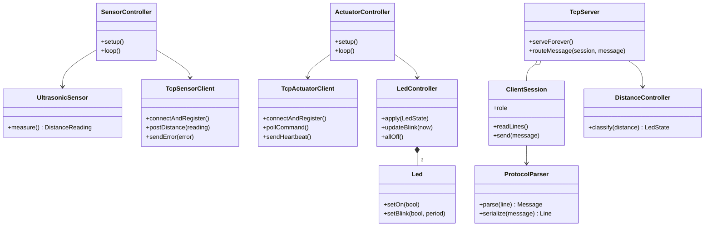

# Architecture Spine — Practica2 IoT TCP

## Paradigma de diseño

Sistema cliente-servidor modular: cada ESP32 es un cliente TCP independiente; el servidor Python centraliza la clasificación y retransmite órdenes. Los firmwares comparten un solo proyecto PlatformIO y se aíslan por entorno de compilación.

## Invariantes y reglas

### AD-1 — Un proyecto PlatformIO, dos firmwares [ADOPTED]

- **Binds:** `sensor`, `actuator`.
- **Prevents:** divergencia de configuración y compilación accidental de ambos `main.cpp`.
- **Rule:** mantener `[env:sensor]` y `[env:actuator]` en el mismo `platformio.ini`; ambos usarán `board = esp32doit-devkit-v1` y `framework = arduino`. Cada entorno tendrá su propio `build_src_filter`, compilando su firmware y las unidades compartidas permitidas.

### AD-2 — Código compartido explícito [ADOPTED]

- **Binds:** código C++ empleado por más de un firmware.
- **Prevents:** duplicación de utilidades realmente comunes y acoplamiento de un entorno al `main.cpp` del otro.
- **Rule:** guardar unidades compartidas reales en `src/shared/`; incluir `shared/` en ambos filtros. Si una clase no la usan ambos firmwares, queda en el directorio del firmware que la utiliza. Los encabezados públicos residen en `include/`.

### AD-3 — Servidor Python fuera de la compilación PlatformIO

- **Binds:** servidor TCP.
- **Prevents:** que archivos Python entren al árbol de fuentes C++ o que el firmware asuma comunicación ESP32 a ESP32.
- **Rule:** guardar el servidor bajo `server/`, fuera de `src/`. Sensor y actuador inician conexiones TCP independientes al servidor; el servidor es el intermediario obligatorio.

### AD-4 — Control centralizado y salida segura

- **Binds:** clasificación de distancia y actuador.
- **Prevents:** reglas duplicadas o divergentes y LEDs activos ante datos inválidos o pérdida de comunicación.
- **Rule:** el servidor Python clasifica rangos y decide el comando. El actuador arranca con los tres LEDs apagados y permanece así hasta un `SET` derivado de una medición fresca válida; error, `ERROR`, timeout de dato, comando inválido o pérdida de enlace llevan a apagado. El parpadeo no bloquea TCP. El deadman vence 1.5 s después del último `POST` válido (o del registro si aún no hay lectura válida); únicamente un `POST` válido nuevo reinicia su referencia temporal. Un `ERROR` invalida inmediatamente la lectura previa, sin reiniciar ni extender el deadman. Es independiente del heartbeat del actuador.

### AD-5 — Línea de comandos separada por entorno

- **Binds:** compilación y carga de cada placa.
- **Prevents:** construir o cargar el firmware equivocado durante preparación y defensa.
- **Rule:** compilar con `pio run -e sensor` o `pio run -e actuator`; cargar con `pio run -e sensor -t upload` o `pio run -e actuator -t upload`, seleccionando el puerto de la placa conectada cuando sea necesario.

### AD-6 — Heartbeat para detectar pérdida del servidor [ADOPTED]

- **Binds:** disponibilidad de sesión TCP del actuador en reposo.
- **Prevents:** mantener LEDs encendidos indefinidamente cuando una conexión desaparece sin cierre TCP detectable de inmediato.
- **Rule:** el actuador envía `PING` cada 2 s; el servidor cierra sesión si no recibe `PING` durante 6 s y el actuador apaga si no recibe un `PONG` correspondiente durante 6 s. El sensor usa la vigilancia separada de datos; ambos ESP32 se reconectan independientemente. Valores iniciales sujetos a validación en banco.

### AD-7 — Salidas LED fuera de pines de arranque [ADOPTED]

- **Binds:** asignación de GPIO para los tres LEDs y arranque fiable de la placa.
- **Prevents:** cargas externas que cambien niveles de strapping durante reset/arranque.
- **Rule:** asignar rojo a GPIO4, amarillo a GPIO21 y verde a GPIO22; TRIG GPIO19 y ECHO GPIO18 con adaptación 5→3.3 V. No usar GPIO2 ni GPIO15 para LEDs porque son strapping pins del ESP32 clásico. Mantener resistencia serie independiente de 220/330 Ω para cada LED y validar el montaje en la placa concreta antes de energizar.

### AD-8 — ECHO protegido a nivel lógico [ADOPTED]

- **Binds:** interfaz eléctrica HC-SR04–ESP32.
- **Prevents:** aplicación directa de una señal potencialmente de 5 V a un GPIO de 3.3 V.
- **Rule:** insertar adaptación de nivel entre ECHO y GPIO18; compartir GND entre sensor y placa. El diseño final del divisor/traslador se fijará según el módulo real y se verificará antes de energizar.

### AD-9 — Estado y órdenes serializados por el servidor [ADOPTED]

- **Binds:** concurrencia de sesiones y propiedad del estado actual de distancia/actuación.
- **Prevents:** comandos fuera de orden, doble escritura concurrente al socket del actuador y reactivación a partir de mediciones obsoletas.
- **Rule:** un coordinador único mantiene medición vigente y secuencia de `SET`; atiende las dos sesiones concurrentes y serializa y confirma las órdenes al actuador en orden creciente. Una sesión de actuador recién registrada queda en `SAFE_OFF` hasta un `POST` válido recibido después de ese registro; no replay de órdenes ni medidas guardadas.



## Modelo de clases propuesto

Las clases son una primera división de responsabilidades para el diseño; se ajustarán antes de implementar. No se asume que haya una clase compartida entre ambos firmware: `src/shared/` recibirá código solo si una unidad concreta resulta genuinamente utilizada por ambos.



## Convenciones de consistencia

| Aspecto | Convención |
| --- | --- |
| Entornos | Nombres exactos `sensor` y `actuator` en PlatformIO y en `src/`. |
| Fuentes | Un `main.cpp` por entorno; nada de fuentes compartidas salvo clases realmente usadas por ambos. |
| Filtros | Rutas relativas a `src_dir`; incluir solo el directorio del entorno activo y `shared/`. |
| Python | Código del servidor y sus pruebas fuera de `src/`. |
| Seguridad | Error o pérdida de enlace produce LEDs apagados. |
| Protocolo | IoT-Range/1 usa líneas ASCII LF/CRLF con `REGISTER`, `POST`, `SET`, `ERROR`, `ACK` y `PING/PONG` del actuador cada 2 s con timeout de heartbeat de 6 s. El deadman independiente del sensor es 1.5 s desde el último `POST` válido (o `REGISTER` si aún no hay uno); `ERROR` invalida de inmediato sin reiniciarlo. Valores sujetos a validación. |

## Stack y estructura semilla

| Componente | Tecnología |
| --- | --- |
| Firmware sensor y actuador | C++, Arduino, PlatformIO; ESP32 DOIT DEVKIT V1 |
| Servidor | Python 3, biblioteca estándar `socket` |
| Transporte | WiFi IEEE 802.11 y TCP/IP; framing de línea LF/CRLF propuesto en IoT-Range/1 |

```text
Practica2/
├── platformio.ini
├── src/
│   ├── sensor/main.cpp
│   ├── actuator/main.cpp
│   └── shared/                 # solo clases genuinamente compartidas
├── include/                    # encabezados compartidos
├── server/                     # servidor Python, fuera de src_dir
├── test/                       # pruebas PlatformIO del firmware, si aplican
└── _bmad-output/planning-artifacts/
```

Configuración objetivo, aún por aplicar al archivo real:

```ini
[platformio]
default_envs = sensor, actuator

[env]
platform = espressif32
board = esp32doit-devkit-v1
framework = arduino

[env:sensor]
build_src_filter = +<sensor/> +<shared/>

[env:actuator]
build_src_filter = +<actuator/> +<shared/>
```

PlatformIO define `build_src_filter` como selección de archivos dentro de `src_dir` y admite patrones de inclusión/exclusión. Los filtros anteriores son un esquema inicial; se deberán confirmar contra la estructura fuente definitiva. Documentación: [PlatformIO `build_src_filter`](https://docs.platformio.org/en/stable/projectconf/sections/env/options/build/build_src_filter.html).

## Planificación de ejecución

1. Confirmar requerimientos y rúbrica al incorporar `Práctica_2.md`.
2. Cerrar el protocolo TCP y las decisiones de pines/circuitos antes de implementar.
3. Reorganizar las fuentes en los directorios por entorno y mantener una única configuración PlatformIO.
4. Implementar y compilar el firmware de cada entorno por separado.
5. Implementar y ejecutar el servidor con Python desde `server/`.
6. Cargar cada firmware únicamente a la placa correspondiente.
7. Ejecutar pruebas de protocolo, límites, errores, reconexión y comportamiento físico; registrar resultados y evidencias sin anticiparlos.

## Mapa de capacidades

| Capacidad | Ubicación | Gobierno |
| --- | --- | --- |
| Medición ultrasónica y envío | `src/sensor/` | AD-1, AD-2, AD-5 |
| Clasificación de distancia y encaminamiento | `server/` | AD-3, AD-4 |
| Control de LEDs y recepción de comandos | `src/actuator/` | AD-1, AD-2, AD-4, AD-5 |
| Protocolo y pruebas de integración | `server/`, `test/`, planificación | AD-3, AD-4 |

## Protocolo y verificación

La especificación de mensajes y sus supuestos vive en `../../protocol/TCP-APPLICATION-PROTOCOL.md`; los criterios, objetivos de NFR y casos de prueba viven en `../../REQUIREMENTS-ACCEPTANCE-TESTS.md`. Los documentos se contrastaron con `Práctica_2.md`; los timeouts y framing siguen siendo propuestas del grupo. La práctica exige además, para el informe, diagramas distintos de arquitectura/despliegue, circuito de cada objeto, clases y secuencia (§4.2); el árbol de estructura y el diagrama de bloques de esta spine no los sustituyen.

## Pendiente

- Validar en pruebas los parámetros IoT-Range/1, framing, deadman de sensor y heartbeat (2 s / 6 s) antes de implementarlos.
- Completar diagrama de circuito de cada objeto con hardware/pines reales; el modelo de clases y despliegue propuestos están bosquejados arriba y deben reconciliarse con la implementación futura.
- Identificar durante la implementación qué clases concretas usan ambos firmwares antes de ubicarlas en `shared/`.
- Confirmar GPIO amarillo/verde seguros para arranque; comprobar módulo y continuidad de GND, adaptación de ECHO, resistencias de 220/330 ohmios y alimentación con el montaje real.
- Registrar versiones de plataforma/toolchain y validar la configuración con ambos builds cuando se implemente.
- Confirmar grupo de 2–3 integrantes y plan de commits individuales; cumplir GitHub/LMS-UCB antes del 13 de octubre de 2026.
- Las pruebas físicas y los resultados siguen pendientes; ningún objetivo indicado equivale a resultado demostrado.

## Diseño detallado

El contrato de diseño de componentes, estados, dependencias, circuitos preliminares, secuencias de fallos y configuración de red está en [`DETAILED-ARCHITECTURE.md`](DETAILED-ARCHITECTURE.md). Especifica el diseño previsto sin representar hardware ensamblado ni resultados experimentales.
