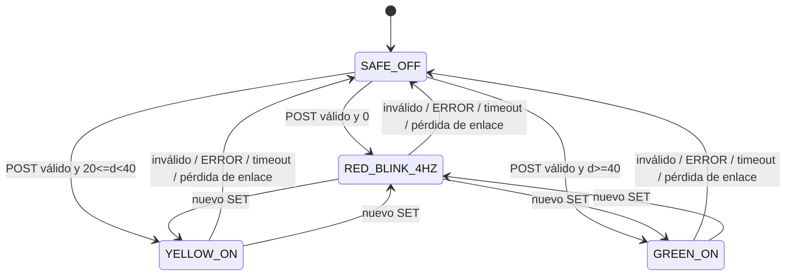

# Arquitectura detallada — Práctica 2 IoT TCP

Este documento desarrolla el diseño de componentes y sus contratos para orientar historias técnicas. No constituye implementación, plano final de fabricación ni evidencia de pruebas físicas. Los objetivos cuantitativos y tiempos continúan sujetos a validación real.

## 1. Componentes y límites

| Componente | Responsabilidad | No debe hacer |
| --- | --- | --- |
| Firmware sensor (`env:sensor`) | Conectar a WiFi, medir HC-SR04, validar la lectura, reportar `POST` o `ERROR`, y reconectar. | Clasificar los rangos ni controlar LEDs. |
| Firmware actuador (`env:actuator`) | Registrar sesión, recibir/aplicar `SET`, confirmar aplicación, mantener heartbeat, parpadear sin bloqueo y apagar salidas localmente si se pierde la sesión. | Inferir distancia ni reutilizar comandos antiguos tras reconectar. |
| Servidor TCP Python | Aceptar sesiones independientes, validar protocolo, controlar frescura de datos, clasificar distancia, producir `SET` completo y registrar eventos útiles para diagnóstico. | Comunicarse con las placas por HTTP/MQTT o abrir enlace ESP32-a-ESP32. |
| Red WLAN/TCP | Transportar el flujo de bytes del protocolo propio. | Proporcionar límites de mensaje: la aplicación delimita las líneas con LF. |

El alcance de una clase compartida se evalúa por uso real de ambos entornos. Inicialmente no se presume ninguna clase común; si parser/serializador se comparte realmente entre los dos firmwares, se ubica en `src/shared/`.

## 2. Módulos y contratos de clases

### Sensor

- `SensorController`: coordina ciclo de medición, estado WiFi, conexión TCP y envío; el ciclo no supera 500 ms como objetivo de muestreo válido, sujeto al tiempo del HC-SR04.
- `UltrasonicSensor`: dispara TRIG, mide pulso ECHO con límite temporal y devuelve un resultado tipado válido/inválido; nunca transforma timeout en una distancia numérica.
- `TcpSensorClient`: conexión y `REGISTER`, envío de `POST`/`ERROR`, lectura de respuestas y reintento con registro fresco.
- `SensorConfig`: GPIO, host/IP, puerto, credenciales fuera del repositorio y parámetros iniciales configurables.

### Actuador

- `ActuatorController`: coordina sesión, mensajes entrantes, heartbeat, temporizadores y deadman.
- `TcpActuatorClient`: `REGISTER`, recepción de líneas, `PING/PONG`, `ACK`/`ERROR`, cierre y reconexión.
- `LedController`: aplica atómicamente la asignación completa de LEDs; apaga todos antes de pasar a otro estado; mantiene el parpadeo mediante temporizador no bloqueante de 125 ms por transición (4 ciclos completos/s).
- `LedState`: valores `SAFE_OFF`, `RED_BLINK_4HZ`, `YELLOW_ON`, `GREEN_ON`. El parser convierte únicamente las combinaciones admitidas del protocolo.

### Servidor

- `TcpServer`: escucha puerto configurable (5000 inicial), acepta clientes y mantiene como máximo una sesión activa por rol.
- `ClientSession`: lector incremental de líneas, escritor serializado por socket, rol/ID y estado de sesión.
- `ProtocolParser` / serializador: validación de forma, ASCII, campos, secuencias y límites de longitud; errores de framing no producen acciones de actuador.
- `RangeClassifier`: función determinista pura con desigualdades: `0 < d < 20`, `20 <= d < 40`, `d >= 40`.
- `MeasurementCoordinator`: conserva solo la última medición fresca y válida. Solo un `POST` válido reinicia la marca temporal del deadman de 1.5 s; `ERROR`, timeout o desconexión invalidan inmediatamente la lectura y solicitan apagado, pero nunca renuevan esa marca temporal. Tras `REGISTER`, si aún no existe `POST` válido, el estado es seguro y el deadman corre desde el registro.
- `ActuatorCommandQueue`: un solo escritor para los `SET`, secuencia creciente, espera de `ACK applied`, cierre ante ambigüedad/timeout.
- Concurrencia del servidor: bucle de eventos `selectors` de biblioteca estándar para sesiones y temporizadores; el coordinador es propietario único del estado de frescura/decisión, y una cola serializa los `SET`. No se introducen procesos ni dependencias externas.

La clasificación permanece en Python. No se añade persistencia, interfaz gráfica, nube ni lógica de administración de dispositivos.

## 3. Asignación preliminar de pines y compatibilidad eléctrica

Pinout aprobado: TRIG GPIO19, ECHO GPIO18 con adaptación de 5 V a 3.3 V; LED rojo GPIO4, amarillo GPIO21 y verde GPIO22. Espressif identifica GPIO2 y GPIO15 como pines de strapping del ESP32 clásico; GPIO4, GPIO18, GPIO19, GPIO21 y GPIO22 figuran como GPIO de uso general. Los niveles de los pines de strapping se muestrean durante reset/arranque, por lo que los LEDs no se asignan a GPIO2/GPIO15.

| Función | Pin propuesto | Revisión | Estado documental |
| --- | ---: | --- | --- |
| HC-SR04 TRIG | GPIO19 | GPIO de uso general; verificar umbral de entrada del módulo exacto. | Aprobado por el usuario. |
| HC-SR04 ECHO | GPIO18 | GPIO de uso general; adaptación obligatoria de 5 V a 3.3 V. | Aprobado por el usuario. |
| LED rojo | GPIO4 | GPIO de uso general, no strapping. Resistor serie 220/330 Ω. | Aprobado por el usuario. |
| LED amarillo | GPIO21 | GPIO de uso general, no strapping. Resistor serie 220/330 Ω. | Aprobado por el usuario. |
| LED verde | GPIO22 | GPIO de uso general, no strapping. Resistor serie 220/330 Ω. | Aprobado por el usuario. |

Para ESP32 con VDD=3.3 V, la especificación DC de Espressif limita `VIH` a VDD+0.3 V (3.6 V). Una salida ECHO potencial de 5 V no debe conectarse directamente; insertar el adaptador obligatorio y verificar la señal en el módulo real. Esta revisión no fija resistencias del divisor/conversor porque varían las implementaciones de HC-SR04. TRIG directo solo tras confirmar el umbral de entrada del módulo real. Cada LED lleva resistencia propia de 220 o 330 Ω en serie; confirmar caída/corriente con los LEDs montados. Todas las partes comparten GND.

Referencias primarias: [GPIO & RTC GPIO — ESP32, Espressif](https://docs.espressif.com/projects/esp-idf/en/stable/esp32/api-reference/peripherals/gpio.html), [ESP32 Hardware Design Guidelines — Schematic Checklist](https://docs.espressif.com/projects/esp-hardware-design-guidelines/en/latest/esp32/schematic-checklist.html), [ESP32 Datasheet — Electrical Characteristics](https://www.espressif.com/sites/default/files/documentation/esp32_datasheet_en.pdf).

### Circuito sensor (conceptual, no conectar hasta confirmar modelo y divisor)

```text
ESP32 DOIT V1                         HC-SR04
5V/VIN (según alimentación validada) ─ VCC
GND ───────────────────────────────── GND
GPIO19 ────────────────────────────── TRIG
GPIO18 ◀──── adaptación de nivel ◀──── ECHO

La adaptación debe limitar el nivel que llega a GPIO18 al máximo permitido.
```

### Circuito actuador (conceptual; amarillo/verde pendientes)

```text
GPIO4  ─ resistencia 220/330 Ω ─ LED rojo    ─ GND
GPIO21 ─ resistencia 220/330 Ω ─ LED amarillo ─ GND
GPIO22 ─ resistencia 220/330 Ω ─ LED verde    ─ GND
```

La dirección física del LED y su caída de tensión se comprobarán antes de alimentar. Criterio: los tres LEDs permanecen apagados desde encendido/reset hasta un `SET` generado por una medición fresca válida, incluso con GPIO en alta impedancia. La topología/polaridad y cualquier pull-down necesario quedan sujetos a inspección eléctrica del montaje; el firmware por sí solo no demuestra este criterio.

## 4. Estados y reglas de datos



- La ventana de medición inicial para validación física es 5–100 cm; los valores fuera de la ventana que se declare luego para ese módulo se reportan inválidos, no se clasifican como rango alto.
- El deadman de datos de 1.5 s corre desde el último `POST` válido y solo un nuevo `POST` válido puede reiniciarlo. Si todavía no hubo uno tras registrar el sensor, el estado es seguro y el conteo comienza en ese registro. Un `ERROR` o cierre del sensor invalida inmediatamente la medición previa y ordena apagado, pero no mueve ni amplía la referencia temporal; un timeout también invalida. Al registrar/reconectar el actuador, se borra el estado aplicable y solo se permite un `SET` derivado de un `POST` válido recibido después de ese registro.
- Cada distancia de referencia usa cinco mediciones; reportar cada valor y error absoluto máximo. Exactitud objetivo ≤3 cm, no demostrada.
- Frecuencia mínima objetivo: 2 lecturas válidas/s en condiciones de eco válido. Respuesta extremo a extremo objetivo ≤1 s. Estabilidad objetivo ≥10 min.
- Las pruebas exactas de umbral (19.9, 20.0, 20.1, 39.9, 40.0, 40.1) pertenecen al clasificador automatizado. Una prueba física anota referencia y lectura del HC-SR04; no afirma discriminación de 0.1 cm.

## 5. Secuencia de error y reconexión

1. Timeout de eco: sensor invalida cualquier lectura precedente y reporta `ERROR`; no envía un `POST` numérico sustituto.
2. Servidor invalida estado vigente y envía `SET` de los tres LEDs apagados; si no puede contactar al actuador, queda registrado el fallo y el deadman local lo lleva a apagado.
3. Si hay desconexión TCP/WiFi, actuador apaga localmente; ambos clientes reintentan por separado y repiten `REGISTER`.
4. Al abrir la sesión, el actuador permanece apagado. No se reenvía el último `SET` ni se reactiva por una medición guardada; espera una medición válida nueva.
5. Un `SET` inválido/antiguo provoca apagado inmediato y error; no aplica un estado parcial.

| Temporizador | Valor inicial | Efecto |
| --- | ---: | --- |
| Frescura del sensor | 1.5 s desde último `POST` válido | Invalida dato y solicita apagado. |
| Heartbeat actuador | `PING` cada 2 s | `PONG` inmediato del servidor. |
| Sesión actuador | 6 s sin `PING` en servidor / sin `PONG` correspondiente en actuador | Cierre de sesión y salida segura. |
| ACK de comando | 500 ms | Sin `ACK applied`, cerrar sesión y llevar actuador a estado seguro. |
| Respuesta extremo a extremo | meta ≤1 s | Medir lectura válida→salida; temporizadores iniciales no garantizan la meta. |

Los tiempos son iniciales y se validan con WiFi real. Intentos de conexión y backoff constan en `TCP-APPLICATION-PROTOCOL.md`.

## 6. Configuración y despliegue

- Un único `platformio.ini`, objetivo `esp32doit-devkit-v1`, Arduino, dos filtros independientes `src/sensor/` y `src/actuator/`; incluir `src/shared/` solo si una unidad es usada por ambos.
- Ejecutar/compilar y cargar cada entorno por separado; seleccionar puerto serie correcto para la placa conectada.
- Ejecutar Python con biblioteca estándar desde `server/`; escuchar inicialmente en puerto 5000 y permitir IP/host servidor configurable en clientes.
- SSID y contraseña se configuran fuera de control de versiones. Los nombres de archivos y variables concretos se decidirán en historias técnicas; ninguna credencial se documenta como valor.
- Redes, librerías y versiones no fijadas aquí salvo el framework Arduino de PlatformIO; fijar versiones reales al iniciar implementación y reportarlas en el informe.

## 7. Diagramas que faltan para informe final

Este paquete contiene despliegue, secuencia del protocolo y estructura de clases. El informe debe presentar diagramas separados legibles: arquitectura/despliegue; circuito sensor; circuito actuador; clases estructural; secuencia con mensajes. Los circuitos se actualizarán a los pines aceptados y los componentes reales antes de defensa. No usar estos dibujos conceptuales como evidencia de circuito construido.
