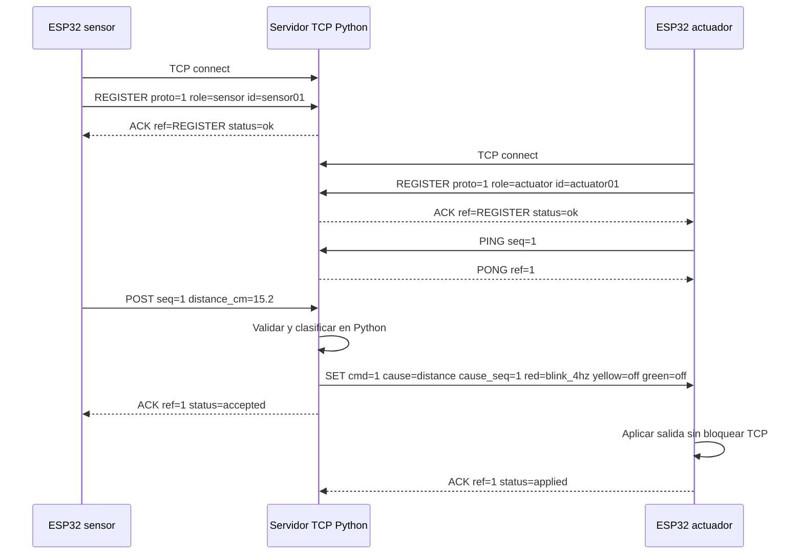

# Protocolo de aplicación TCP — IoT-Range/1

**Estado:** contrato de diseño aprobado para planificación; los valores de temporización son iniciales y quedan sujetos a validación real. La práctica exige un protocolo propio documentado, pero no fija esta sintaxis ni sus timeouts. No es implementación ni prueba de interoperabilidad.

## 1. Propósito, participantes y conexión

IoT-Range/1 lleva el registro de dos ESP32, lecturas, órdenes completas de LEDs, confirmaciones, heartbeat y errores. Sensor y actuador son clientes TCP independientes y ambos inician conexiones al servidor Python, que se ejecuta en una PC dentro de la WLAN IEEE 802.11. No existe conexión directa entre placas. Python es el único responsable de clasificar distancias.

El servidor enlaza todas las interfaces de la PC en el puerto TCP `5000` (valor predeterminado propuesto). Los ESP32 reciben el host/IP LAN por configuración local; SSID/contraseña no son mensajes de protocolo ni se incluyen en el repositorio. El puerto y host pueden configurarse para la red de demostración.

## 2. Framing y sintaxis

- Codificación ASCII; cada mensaje termina en LF (`0x0A`). Se acepta CRLF quitando un único CR inmediatamente anterior al LF.
- TCP es flujo de bytes: acumular bytes hasta LF; una línea puede estar fragmentada entre lecturas y una lectura puede contener varias líneas. Procesar solo mensajes completos.
- Máximo propuesto: 256 bytes por línea antes del terminador. Al excederlo, enviar `ERROR code=line_too_long` si es posible y cerrar la conexión.
- Forma: `VERB SP key=value (SP key=value)* LF`. No hay espacios en valores. Verbos y claves son sensibles a mayúsculas; los verbos se escriben en mayúsculas.
- Rechazar línea vacía, clave duplicada/desconocida, campo ausente, byte no ASCII, sintaxis inválida y fin de conexión con línea incompleta. No intentar continuar parsing después de una línea malformada.
- `id`: `[A-Za-z0-9_-]{1,32}`; `reason`: `[A-Za-z0-9_-]{1,64}`. `seq`, `cmd`: entero decimal positivo de 1 a 2,147,483,647 por sesión. `distance_cm`: decimal con punto y al menos un dígito; no admite signo, coma, notación científica, NaN ni infinito. Solo valores finitos `>0` son válidos.
- Campos obligatorios y orden de campos son los de las formas de cada verbo. `REGISTER` es el primer mensaje de cada conexión; una reconexión requiere nuevo registro.

## 3. Mensajes, dirección y validación

| Mensaje | Dirección | Sintaxis y campos requeridos | Respuesta/efecto |
| --- | --- | --- | --- |
| `REGISTER` | Cualquier cliente → servidor; primero | `REGISTER proto=1 role=sensor id=sensor01` (o `role=actuator`) | Verifica versión, rol e ID. Éxito: `ACK ref=REGISTER status=ok`. Error: `ERROR code=...` y cierre. |
| `POST` | Sensor → servidor | `POST seq=1 distance_cm=15.2` | Solo sensor registrado; secuencia ascendente; distancia finita >0 y dentro del rango físico validado. Servidor clasifica y responde `ACK ref=1 status=accepted`. |
| `SET` | Servidor → actuador | `SET cmd=1 cause=distance cause_seq=1 red=blink_4hz yellow=off green=off` | Solo actuador registrado; comando completo para los tres LEDs; `cmd` ascendente; `cause` permitido; `cause_seq` secuencia o `none`. Tras aplicar: `ACK ref=1 status=applied`. |
| `ERROR` | Cliente ↔ servidor | `ERROR code=invalid_reading seq=2 reason=echo_timeout`; `seq` se omite cuando no aplique | Código de lista cerrada. Error sensor de lectura: invalida medida y obliga estado seguro. Error actuator: apaga salidas localmente, avisa servidor. Errores no recuperables llevan cierre de sesión. |
| `ACK` | Servidor → cliente; actuador → servidor | `ACK ref=REGISTER status=ok`; `ACK ref=2 status=accepted`; `ACK ref=7 status=applied` | Únicos estados válidos: `ok` para REGISTER, `accepted` para POST, `applied` para SET. `ref` corresponde al registro, secuencia o comando pendiente. Confirma procesamiento/aplicación de la sesión, no persistencia. |
| `PING` | Actuador → servidor | `PING seq=1` | Heartbeat ascendente cada 2 s (inicial, sujeto a validación). |
| `PONG` | Servidor → actuador | `PONG ref=1` | Respuesta inmediata; `ref` debe coincidir con `PING.seq`. Su ausencia activa modo seguro y reconexión. |

El servidor acepta como máximo una sesión activa por rol. Si una sesión de ese rol sigue activa, rechaza la nueva con `ERROR code=role_in_use`; tras detectar y cerrar la sesión antigua se permite reconectar con el mismo ID. `seq` y `cmd` empiezan en 1 por sesión y no se reutilizan dentro de esa sesión. No se procesan `POST` o `SET` antes del registro ni mensajes de dirección/rol incorrecto.

## 4. Clasificación y contrato de salida

| Condición | `red` | `yellow` | `green` |
| --- | --- | --- | --- |
| `0 < distance_cm < 20` | `blink_4hz` | `off` | `off` |
| `20 <= distance_cm < 40` | `off` | `on` | `off` |
| `distance_cm >= 40` | `off` | `off` | `on` |
| Inicialización, medida inválida, timeout, error o pérdida de enlace | `off` | `off` | `off` |

Estos rangos y las salidas corresponden a la decisión aprobada del proyecto; los ejemplos del enunciado son solo ilustrativos. `blink_4hz` son cuatro ciclos completos por segundo: período 250 ms con 125 ms encendido y 125 ms apagado. El actuador implementa la fase sin bloquear la recepción TCP. `SET` reemplaza el estado completo: primero apaga los tres LEDs y luego aplica la combinación; valores LED permitidos: `red=off|on|blink_4hz`, `yellow=off|on`, `green=off|on`. Se rechaza más de un LED activo. Una lectura inválida nunca se convierte en distancia alta.

`cause` es uno de `distance`, `invalid_reading`, `sensor_timeout`, `sensor_disconnected`, `startup`, `reconnected`. `cause_seq` es entero válido o `none`. La condición inválida lleva estado totalmente apagado.

## 5. Secuencia nominal



El orden de `ACK accepted` y `SET` no es un requisito de la práctica; en el borrador el servidor encola ambos sin bloquear el procesamiento. Para cada medida válida envía un `SET` completo. Para cada lectura inválida emite un `SET` completo de apagado.

El servidor mantiene un solo escritor por socket actuador y envía los `SET` en orden de `cmd`; cada uno se confirma individualmente. Si un `SET` no obtiene `ACK applied` dentro de 500 ms, cierra la sesión en vez de dejar comandos ambiguos pendientes. El procesamiento del sensor y sus timeouts no debe bloquearse mientras el escritor espera confirmación.

## 6. Errores, timeouts y reconexión

Los tiempos de esta tabla son propuestas iniciales para hacer verificable el comportamiento; no son valores impuestos por la rúbrica ni resultados de medición. El conjunto debe satisfacer el objetivo de respuesta extremo a extremo ≤1 s.

| Evento | Acción segura y recuperación propuesta |
| --- | --- |
| Conexión inicial no lograda en 5 s | Cerrar intento; reintentar con backoff 1, 2, 4, 8… hasta 30 s. Cada conexión nueva empieza con REGISTER. |
| No llega un `POST` válido nuevo durante 1.5 s desde el último `POST` válido (o desde el registro del sensor si todavía no hay uno) | Invalida cualquier medida vigente; servidor manda `SET` todo apagado y registra `sensor_timeout`. El deadman de datos es independiente del heartbeat de sesión del actuador. |
| Lectura inválida reportada por sensor mediante `ERROR` | Servidor invalida la medida anterior inmediatamente y manda apagado; el `ERROR` no renueva ni reinicia el deadman. Solo un `POST` válido nuevo actualiza la referencia temporal y puede establecer una medida válida. No clasifica el error como distancia alta. |
| Sensor desconectado | Al detectar cierre, servidor manda apagado si hay actuador conectado. Si no puede, actuador mantiene apagado localmente al perder servidor. |
| Actuador sin `PING` por 6 s | Servidor cierra sesión. El actuador también apaga LEDs tras 6 s sin `PONG`, luego reconecta y registra otra vez. No necesita recibir un comando para llegar a seguro. |
| Servidor inaccesible | La falta de `PONG` lleva actuador a apagado; ambos ESP32 reintentan de forma independiente. |
| `SET` inválido o secuencia antigua | Actuador no lo aplica, apaga los tres LEDs, envía `ERROR`; servidor registra y cierra la sesión si hay violación de protocolo. |
| `SET` sin `ACK applied` tras 500 ms | Servidor registra `ack_timeout` y cierra sesión para inducir modo seguro local del actuador. Tiempo propuesto. |
| Línea malformada, rol/dirección indebida o campo inválido | Enviar `ERROR` si se puede; registrar; cerrar sesión ante error no recuperable. Nunca traducir error a salida activa. |
| Mensaje parcial al cerrar | Descartar línea parcial. Si corresponde a pérdida del sensor, activar apagado. |
| Actuador se reconecta | Registrar y permanecer apagado hasta recibir un `SET` generado por una medida válida nueva; no replay de medida histórica. |

No se aplica timeout de inactividad genérico a todas las sesiones: la frescura del sensor se vigila exclusivamente mediante el tiempo desde el último `POST` válido, mientras el actuador envía `PING` periódico porque normalmente solo recibe `SET`. Un `ERROR` invalida el dato actual en el acto, pero no cuenta como muestra ni mueve la marca temporal del deadman; errores repetidos tampoco prolongan la frescura. Después del registro, si todavía no hay `POST` válido, el estado es seguro y el deadman corre desde ese registro. El heartbeat de aplicación permite detectar un servidor que deja de responder aun si no hay cambios de rango. Lecturas/escrituras TCP deben tener timeout y reconstruir líneas; ninguna llamada equivale necesariamente a un mensaje completo.

## 7. Códigos de error y ejemplos

Códigos iniciales: `invalid_reading`, `measurement_timeout`, `malformed_message`, `unknown_command`, `invalid_parameter`, `role_violation`, `role_in_use`, `stale_sequence`, `line_too_long`, `ack_timeout`, `actuator_unavailable`, `internal_error`.

```text
S -> P: ERROR code=invalid_reading seq=8 reason=echo_timeout\n
P -> A: SET cmd=8 cause=invalid_reading cause_seq=8 red=off yellow=off green=off\n
A -> P: ACK ref=8 status=applied\n
A -> P: PING seq=9\n
P -> A: PONG ref=9\n
```

## 8. Parámetros iniciales sujetos a validación

- Revisar si se conserva ASCII + LF/CRLF y límite de 256 bytes.
- Validar en banco heartbeat PING/PONG del actuador cada 2 s y timeout de 6 s; el timeout específico evita cerrar por inactividad a un actuador receptor.
- Confirmar 5 s de conexión, 1.5 s de sensor, 500 ms de ACK, backoff y puerto predeterminado TCP/5000.
- Establecer el rango físico validado del HC-SR04 y las condiciones que definen medida inválida.
- Confirmar host LAN configurable y cómo se obtiene IP estable de la PC en la red de demostración.
- La práctica no exige autenticación; revisar si la red local/laboratorio establece una política adicional.

Los objetivos adoptados de hardware y medición asociados son: ventana inicial de 5–100 cm; cinco lecturas por distancia de referencia; error absoluto máximo objetivo de 3 cm; al menos dos lecturas válidas por segundo; respuesta de extremo a extremo no mayor de 1 s; operación continua durante al menos 10 minutos. Son criterios de validación, no resultados. Los seis valores de frontera se prueban automáticamente en el clasificador; la prueba física registra lecturas reales y no presupone que el sensor distinga cambios de 0.1 cm.
